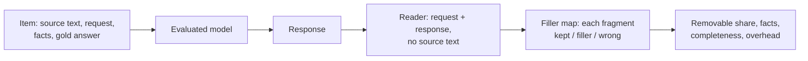
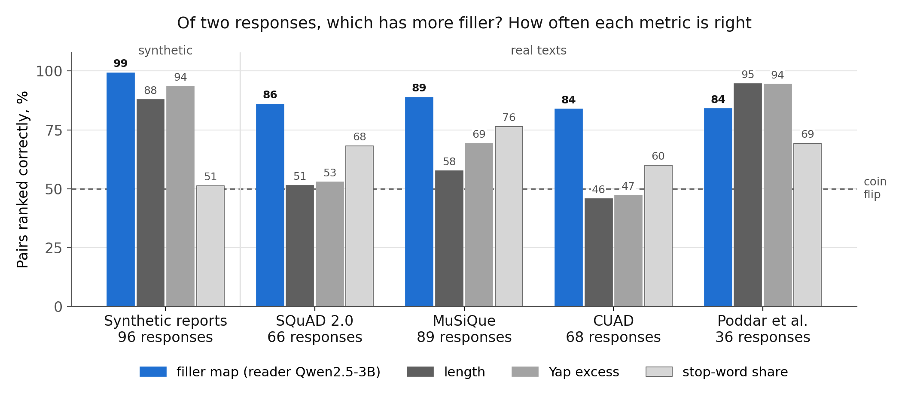

# Filler in LLM answers

Code and results for a paper on filler in LLM answers: text that adds length but no requested information.

A reader model sees only the request and the response and answers a question per requested fact. A fragment of the
response is removable if every fact survives its deletion. Removable fragments are filler or wrong statements. The
benchmark applies this to synthetic reports and four real-text datasets, with checks against known truth and human
labels.



## Status (October 2026)

- Code v1.1.0 (package `drybench`). Fixes answer matching: a correct answer in the response's own words is credited.
- Results: development runs on a Colab T4 (models up to 1.7B, readers Qwen2.5-3B and Phi-3.5-mini), scored by
  v1.0.0; to be rescored with v1.1.0.
- Next: rescoring, the confirmation run on an A100, human labels.

## Filler map vs simple metrics



Metric: pairwise accuracy. Take two responses from one dataset whose true filler shares differ by at least 20
percentage points. A metric is right if it gives the response with more filler the higher score; a tie counts half.
50% is a coin flip, 100% is always right. With a two-class truth this is ROC-AUC.

The responses have known filler. They consist of sentences that state the requested facts (templated on synthetic
reports, taken from the source text on real texts) and planted filler: openers, closings, hedges, generic remarks,
restated requests, true but unrequested sentences, summaries. On real texts one condition also plants a wrong
statement, which counts as removable. Development runs, reader Qwen2.5-3B, v1.0.0 scores.

- The filler map is right in 84–99% of pairs on every dataset.
- Length works only where the fact sentences are short, so filler is what makes a response long: synthetic reports
  (median 32 characters) and Poddar et al. (88). On SQuAD 2.0, MuSiQue and CUAD (131–142) it is close to a coin
  flip (46–58%).
- Per fragment (is this fragment filler?) the filler map's ROC-AUC is 0.98 on synthetic reports and 0.79–0.99 on
  real texts. The simple metrics give one number per response and have no per-fragment score.
- Not in the chart: answers of 10 LLMs labelled by people (Poddar et al.). There the filler map is right in 88% of
  pairs and length in 92%: no advantage yet. The human labels of the confirmation run decide it
  ([docs/results.md](docs/results.md)).

The chart is rebuilt by `python scripts/readme_figure.py`.

## Documents

| Document | Contents |
|---|---|
| [docs/method.md](docs/method.md) | reader information, accepted answers, deletion search, kinds of deleted fragments, metrics |
| [docs/benchmark.md](docs/benchmark.md) | item format, synthetic generator, SQuAD 2.0, MuSiQue, CUAD, Poddar et al., leakage filter |
| [docs/validation.md](docs/validation.md) | checks with known truth, human labels, baselines, second reader |
| [docs/results.md](docs/results.md) | development runs: numbers, the v1.0.0 matching issue, open questions |
| [docs/examples.md](docs/examples.md) | one scored response per suite and one per check |
| [docs/running.md](docs/running.md) | install, Colab, GPU server, rescoring, inspecting a run |
| [docs/PROTOCOL.md](docs/PROTOCOL.md) | confirmation run: what is frozen, what is tested |
| [docs/ANNOTATION.md](docs/ANNOTATION.md) | guide for annotators |
| [CHANGELOG.md](CHANGELOG.md) | versions |
| [results/dev_v1.0](results/dev_v1.0/README.md) | tables and raw outputs of the development runs |

## Layout

```text
drybench/     package: reader, filler map, metrics, datasets, baselines, reports
scripts/      runs: synthetic suite, real texts, confirmation run, annotation samples, inspection
colab/        notebooks and their templates (scripts/make_colab.py builds the notebooks)
annotation/   labelling page
tests/        tests (mock reader, no GPU)
results/      dev_v1.0: development runs; pilot: GPT-2 pilot; abstain_labels.json: hand labels
docs/         documents above
```

## Quick start

```bash
pip install -e ".[hf,plot,dev]"
python -m pytest -q          # 161 tests, no GPU
```

Runs with real models need a GPU: [docs/running.md](docs/running.md).
