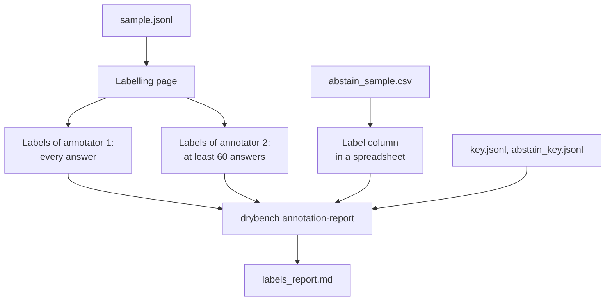

# Human labels

The confirmation run ([PROTOCOL.md](PROTOCOL.md)) writes two samples into `RUN/annotation/` (also
`RUN_annotation.zip`):

| File | What | Time |
|---|---|---|
| `sample.jsonl` | ≈190 answers to label fragment by fragment: 6 items per source (synthetic reports, SQuAD 2.0, MuSiQue, CUAD) × up to 8 answers per item from different models and prompts; each source text is read once for several answers | 2–3 h |
| `abstain_sample.csv` | 150 answers to requests whose source does not give one of the requested facts | 30 min |

`key.jsonl` and `abstain_key.jsonl` name the models and hold the benchmark's own labels. Do not open them until
you finish.



## Fragment labels

1. Open the labelling page: the published page (labels are shared through it) or `RUN/annotation/labelling_page.html`
   (a copy of `annotation/dry_span_labels_offline.html`) in your own browser; labels then stay in that browser
   until exported (one set of labels per browser).
2. Enter your name or initials and load `sample.jsonl`. Answers to the same item come one after another. **Load
   another sample** switches to another file; the labels of each sample stay in the browser.
3. Label every fragment (a sentence or a list line). The guidelines and two examples are on the page ("How to
   label").
   - **Needed**: deleting it loses something the request asks for: a requested value or answer, a step of an
     explanation the request asks for, or the correct statement that the source does not give a requested fact.
   - **Filler**: deleting it loses nothing requested, and nothing in it is wrong.
   - **Wrong**: a wrong answer or a claim the source contradicts. Takes priority; add "+ needed fact" if the fragment
     also gives a requested fact correctly.
   - Keys: 1 / 2 / 3, 4 = + needed fact, U = unsure, Enter = next answer.
4. **Export labels** when done (`span_labels_NAME_DATE.json`). A later export of the same browser is the same
   annotator: the report keeps the latest label of each fragment.

The second annotator labels the same file independently, at least the first 60 answers. The report takes the most
complete annotator as the truth and the other for agreement (Cohen's κ). Response ids carry the sample's id, and
the report refuses labels made on another sample.

## Abstention labels

Open `abstain_sample.csv` in a spreadsheet. For each row read the answer and fill `label (A/B/V/O)` for the question
in "question the source does not answer":

| Label | The answer … |
|---|---|
| A | says the fact is not given |
| B | says so and also guesses a value |
| V | gives a value |
| O | neither (answers something else) |

## Report

```bash
drybench annotation-report --sample RUN/annotation --labels span_labels_me.json span_labels_second.json \
    --abstain-csv abstain_sample_filled.csv
```

`RUN/annotation/labels_report.md`: agreement between annotators; every method against the truth (the filler map of
each reader, the LLM judge and Selective Context, length, Yap excess, stop-word share) over all pairs and over pairs
of answers to the same item, per source; the wrong-statement label; what the filler map did with each human label;
precision and recall of the abstention rule on the held-out labels.

## Chat LLMs as extra annotators (optional)

```bash
python scripts/chat_annotators.py make RUN/annotation/sample.jsonl --out chat/       # prompt + sample in parts
python scripts/chat_annotators.py collect RUN/annotation/sample.jsonl --model gpt chat/gpt_*.txt --out gpt.jsonl
```

Paste the parts into a chat, save the replies, collect, and add `gpt.jsonl` to `--labels` (another annotator). Chat
interfaces do not fix the model version; the reproducible judge is `drybench baselines --method judge`.

## Labels of Poddar et al.

The R4 check needs nothing by hand: their labels come with the data.
