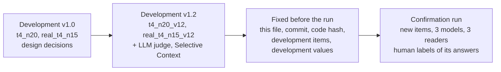
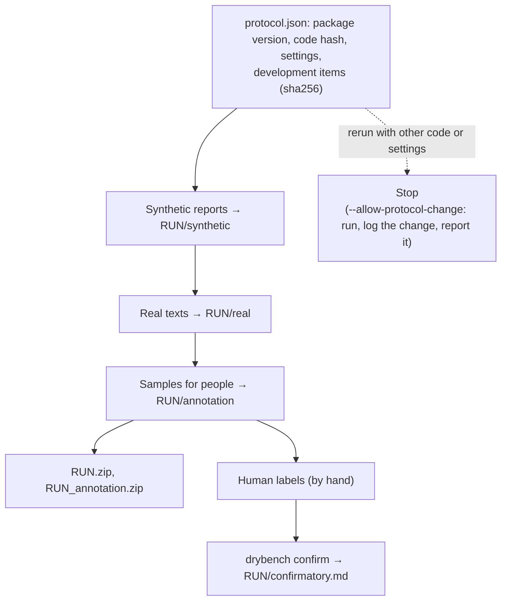

# Protocol of the confirmation run (package v1.2.5)

## Development and confirmation

**Development runs.** All design decisions were made on them.
- v1.0 (`results/dev_v1.0`, Colab T4): synthetic reports `t4_n20` (item seed 0, 20 items per cell) and real texts
  `real_t4_n15` (SQuAD 2.0, MuSiQue, CUAD, Poddar et al.; 15 items per cell); models Qwen2.5-0.5B/1.5B-Instruct and
  SmolLM2-1.7B-Instruct; readers Qwen2.5-3B-Instruct and Phi-3.5-mini-instruct; Poddar et al.'s 189
  human-labelled responses; 600 missing-fact answers labelled while the abstention rule was built.
- v1.2 (the same design after review; scored by package v1.2.1, scoring version 11, which v1.2.5 keeps):
  `t4_n20_v12`, `real_t4_n15_v12` (`results/dev_v1.2`) on a T4, readers in fp16. Then, on the confirmation run's
  server (`colab/dev_baselines_a100.ipynb`): the main reader's copy there scores a sample of their responses again
  (`scripts/compare_reader.py`, fp16 and bf16), and the LLM judge (Qwen2.5-14B) and Selective Context (Qwen2.5-3B)
  run on both. Their values of the confirmatory statistics are [below](#development-values).

**Confirmation run.** `colab/final_a100.ipynb` or `scripts/run_final.py`, package v1.2.5, on one NVIDIA
A100-PCIE-40GB (transformers 4.52.3, accelerate 1.3.0); the models are local folders on that server, nothing is
downloaded:
- synthetic reports: new items (seed 1, 30 per cell, 450 items); planted-filler check T1 on items of seed 2027
  (development: 2026), 5 per cell;
- real texts: SQuAD 2.0, MuSiQue (MuSiQue-Full required), CUAD; 30 items per cell (540 items), built only from
  source texts the development items do not use (below); planted-filler check R3 on 8 items per cell (development:
  4);
- three evaluated models of three families: Llama-3.2-3B-Instruct, Phi-4-mini-instruct (3.8B),
  Qwen2.5-14B-Instruct; prompts default and "Be concise."; plain greedy decoding (the models' own generation
  settings, such as a repetition penalty, are not applied), at most 400 new tokens (answers cut there are flagged),
  bf16;
- three readers: Qwen2.5-3B-Instruct (main; fp16, as in development; not an evaluated model), Phi-4-mini-instruct
  (all answers), Qwen2.5-14B-Instruct (answers to 10 items per cell and the annotation sample); bf16. The second and
  the large reader are also evaluated models: their reading of their own answers enters secondary results only and
  is reported apart;
- LLM judge (Qwen2.5-14B) and Selective Context (Qwen2.5-3B) on every response with known truth, bf16;
- the samples for human labels, drawn from this run's answers (seed 0): ≈190 answers to 32 items (8 per source:
  synthetic, SQuAD 2.0, MuSiQue, CUAD; up to 6 answers per item), fragment labels; 150 answers to missing-fact
  items, abstention labels.

The models are those of the server that its transformers version loads and that fit the GPU in bf16. Left out:
gpt-oss-20b, Ministral 3 14B and Devstral Small 24B (architectures 4.52.3 does not know), Mistral Small 22B and
3.2 24B (~45–48 GB in bf16; 8-bit loading needs bitsandbytes, which the server lacks). The main reader's copy is
stored in float32: three files, sha256 `f3dc170ebfd0a03f62a10df3b8d2c89b24d21586e81cc8e5166db75701fa76c5`,
`027b0f50167c59586e80131e6b9e8d8584678b481a99c774dea1cd13a0e7cd11`,
`ea2e35b5826248eb4b2ec381dc66fdc9305bc9217d59224df127bc26a1eb017f`.

## Exclusions

| What | Rule | Code |
|---|---|---|
| development source texts | no confirmation item uses a SQuAD 2.0 paragraph, a CUAD contract, a MuSiQue question, or a MuSiQue question that shares a single-hop sub-question with an item of either development run (`results/dev_v1.0/real/items.jsonl`, `results/dev_v1.2/real_t4_n15_v12/items.jsonl`); the dataset files are those of the development runs (sha256 checked) | `drybench.realdata.source_keys`, `filter-items --exclude-items`, `run_final.check_data` |
| Poddar et al. | not a suite of the confirmation run: the development human-label check used every question of it usable as an item | `run_final.DEFAULT_SUITES` |
| leaked items | the main reader answers a fact from an empty message (p ≥ 0.05) or cannot read it from the gold answer (p < 0.5) | `drybench.realdata.filter_items` |
| missing-fact items | out of the filler tables, R3 and H1–H3 (their answers are scored for abstention) | `drybench.rescore.has_missing` |
| unreadable gold | a response to an item whose gold answer the reader cannot read is out of that reader's tables (counted) | `drybench.filler` |
| annotation sample | missing-fact items out; items need ≥ 3 distinct answers; identical answers labelled once | `drybench.annotate.build_sample` |

## Frozen

| What | Value | Code |
|---|---|---|
| information a response delivers | I_j = max(ln p, ln ε) − max(ln p∅, ln ε), ε = 10⁻⁶; a reply that ends in a digit must not go on with a digit ("70" is not "700") | `drybench.reader` |
| accepted answers | the gold's forms; for a fact they leave undelivered (p < 0.5), also the response's own wording of it (same words up to case, dashes, quotes, apostrophes, digit separators, '&', accents and articles; CUAD dates and terms by value), with up to 8 words of its phrase in front (never across , ( ) : ; or words such as not / or / than / renew…; a name's modifier such as "North" or "Saint" joins the answer), kept when the reader replies with it at p ≥ 0.02 (best per place, at most 3); the same for each deleted fragment read alone when it is classified | `drybench.forms` |
| delivered fact | I_j ≥ 0.5 nats; a response with less than 1 nat of positive information over all facts has no filler map (its score: all removable, a failed answer) | `drybench.filler` |
| tolerance of the filler map | τ = 0.5 nats, slack min(τ, I_j / 2), every delivered fact separately | `drybench.filler` |
| deletion search | leave-one-out queue; a fragment that cannot go with the ones before it is skipped; then of two statements of the same fact the first full one stays and the later one goes | `drybench.filler` |
| fragments | sentences and list lines; abbreviations and initials do not end a sentence | `drybench.segment` |
| kinds of deleted fragments | wrong statement (p ≥ 0.5 on a wrong answer) before repeat (≥ half of a delivered fact's information) before uninformative; in synthetic reports a fragment whose every value is true is never wrong | `drybench.filler` |
| completeness κ | per fact, the information delivered capped at the gold's | `drybench.filler` |
| missing facts | lexical rule, clause by clause; missing-fact items are left out of the filler tables | `drybench.abstain` |
| readers | chat template; the question about a missing fact per reader (Qwen2.5-3B: yes/no; Phi-4-mini and Qwen2.5-14B: yes/no, the default); main reader fp16, the others bf16 | `drybench.reader`, `run_final --reader-dtype` |
| decoding | plain greedy; the model's generation settings dropped; 400 new tokens; bf16 | `drybench.backends.hf` |
| baselines | length, Yap excess, stop-word share; LLM judge = fragment labels by the annotation guidelines, read off label probabilities; Selective Context = summed token self-information per fragment, as many characters deleted as the main reader's filler map | `drybench.judge`, `drybench.selective` |
| comparisons | the same responses for every method; true share = planted filler and wrong statements, or the fragments labelled filler or wrong (without "+ needed fact"), by characters; primary metrics: pairwise accuracy (pairs whose true share differs by ≥ 0.2, ties half) and Spearman with the true share; 95% CIs from bootstrap resamples of items | `drybench.compare`, `drybench.confirm` |
| human labels | guidelines of v1.0; item-wise sample, seed 0; truth = the annotator with the most complete labels; response ids carry the sample's id and exports are checked against the sample | `drybench.guidelines`, `drybench.annotate` |

## Confirmatory tests

Eight one-sided tests on the main reader (`drybench confirm`, written to `RUN/confirmatory.md`); Holm over the
eight, family-wise α = 0.05. p-values from 2000 bootstrap resamples of items (seed 0): p = (1 + number of
resamples at or beyond the null) / 2001.

| Test | Truth set | Hypothesis | Decision |
|---|---|---|---|
| H1 T1 | planted filler, synthetic reports | on the responses with a filler map, a requested fact is lost in fewer than 5% of them, and more than 0.95 of the deleted fragments are planted filler or planted wrong statements | both: p = the larger of the two p-values (intersection-union) |
| H1 R3 | planted filler, real texts | the same with 15% and 0.85 | the same |
| H2 T1, H2 R3, H2 HL | T1, R3, the human labels of the annotation sample (HL) | pairwise accuracy of the filler map minus that of length > 0 | p of the difference |
| H3 T1, H3 R3, H3 HL | T1, R3, HL | Spearman of the filler map with the true share minus that of length > 0 | p of the difference |

H2 and H3 count every response the truth covers; a response from which the reader reads no requested fact counts
as all removable (the score the benchmark gives it), so a reader failure counts against the filler map. H1 is
about deletions, which only a filler map makes: its share of responses with a map is reported next to it.
A test is confirmed when its Holm-adjusted p ≤ 0.05; each is reported with its estimate and 95% CI whichever way it
comes out.

**Thresholds of H1 R3.** Since v1.2 the truth of R3 keeps a fact only by the sentence chosen to state it or by the
summary. On the development run the main reader lost a fact in 9.2% of the responses: 14 of the 29 lost facts are
read at less than 0.5 nats from the whole response, so their sentence is not protected; in the other 15 a kept
fragment mentions the answer and the reader reads the fact from it, and in 6 of these the kept fragment states the
fact, which the strict truth does not count. The truth stays strict. The thresholds follow a rule fixed before the
development intervals were computed (commit `5218f5c`, [running.md](running.md#rescoring)): the main reader's
development 95% CI bounds rounded outward, the share of responses with a lost fact up to a multiple of 5 points and
the precision down to a multiple of 0.05: [4.7%, 14.3%] → 15%, [0.8996, 0.969] → 0.85. H1 T1 keeps 5% and 0.95.

No formal power analysis: the sizes are set by one A100 run (~6–10 h) and 2–3 h of labelling per annotator. The
development intervals of T1 and of H2/H3 on R3 are far from the nulls; H1 R3's development estimate is inside its
thresholds (without the Poddar et al. items, which the confirmation run does not have: 10.9% [5.6%, 16.8%] lost,
precision 0.924 [0.883, 0.963]), and the confirmation run's R3 has 8 items per cell instead of 4. HL has no
development counterpart (on Poddar et al.'s labels length ranked pairs better than the filler map).

## Development values

`drybench confirm` on `t4_n20_v12` and `real_t4_n15_v12` (main reader Qwen2.5-3B, fp16, T4; R3 includes the
Poddar et al. items).

| Test | Data | Estimate [95% CI] |
|---|---|---|
| H1 T1 | 96 of 96 responses with a map, 24 items | lost 0.0% [0.0%, 0.0%]; precision 1.000 [1.000, 1.000] |
| H1 R3 | 271 of 303 responses with a map, 67 items | lost 9.2% [4.7%, 14.3%]; precision 0.935 [0.900, 0.969] |
| H2 T1 | 96 responses, 24 items, 2380 pairs | 0.992 vs 0.878; difference +0.113 [+0.068, +0.152] |
| H2 R3 | 303 responses, 68 items, 28476 pairs | 0.842 vs 0.515; difference +0.327 [+0.247, +0.396] |
| H3 T1 | 96 responses, 24 items | 0.954 vs 0.630; difference +0.323 [+0.229, +0.397] |
| H3 R3 | 303 responses, 68 items | 0.696 vs 0.044; difference +0.652 [+0.495, +0.777] |
| H2 HL, H3 HL | – | no development counterpart |

## Secondary, with 95% CIs, no tests

1. The other two readers on H1–H3; same-item pairs; pairs where the response with more filler is the shorter one;
   partial Spearman given length; Yap excess and stop-word share; per suite.
2. The LLM judge and Selective Context on the same responses (the judge is the same model as the large reader);
   cost per response.
3. Agreement of the filler map with the primary annotator against the agreement of the two annotators (Cohen's κ).
4. Models: filler by item design; "Be concise." (paired CIs per model); abstention on missing facts per model;
   agreement of model rankings and "Be concise." effects between the three readers, also without each reader's own
   answers.
5. Entropy: whether the generating model's span entropy flags filler above chance.
6. The abstention rule: precision and recall on the held-out labels of 150 answers.
7. The main reader's copy on the server against the development scores: identical kept fragments, |ΔW|, per-fact
   information, in fp16 and bf16.

## Fixed before the confirmation run

1. the commit of the repository that runs (git tag `confirmation-run`), and this file at that commit;
2. `python scripts/run_final.py --print-hash`: package version and code hash (sha1 of `drybench/` and the four run
   scripts; `protocol.json` records the same and stops a rerun with other code);
3. sha256 of both development items files (`results/dev_v1.0/real/items.jsonl`:
   `bbda8f899a2c5ec8abc319f20021f7c3856a610d147f4283ac0434421b02078c`; `results/dev_v1.2/real_t4_n15_v12/items.jsonl`:
   `77358dc937769f9486b0fbb13e7af2195d6c45ad45c8aa874c0a1cf30d9d8ccc`);
4. the development values of the eight statistics ([above](#development-values)) and the thresholds of H1;
5. the machine and the models: GPU and library versions (`hardware.json` of the run), each model folder's origin
   and size from its config (`models.jsonl` of the development step on the server), the main reader's sha256
   (above) and its agreement with the development scores;
6. the annotators: who they are and whether they took part in the development.

A change after the run starts is a deviation: `--allow-protocol-change` logs it in `protocol.json` under
"changes", and the paper reports it. An external timestamp (an OSF registration, private under embargo until
submission) is optional and not made.

## After the run, by hand

1. `annotation/sample.jsonl`: one annotator labels every answer, a second one at least 60
   ([ANNOTATION.md](ANNOTATION.md)).
2. `annotation/abstain_sample.csv`: the label column, without looking at the key.
3. `drybench annotation-report --sample annotation --labels … --abstain-csv …` → `annotation/labels_report.md`.
4. `drybench confirm --run RUN --labels …` → `RUN/confirmatory.md`: the eight tests, Holm-adjusted.
