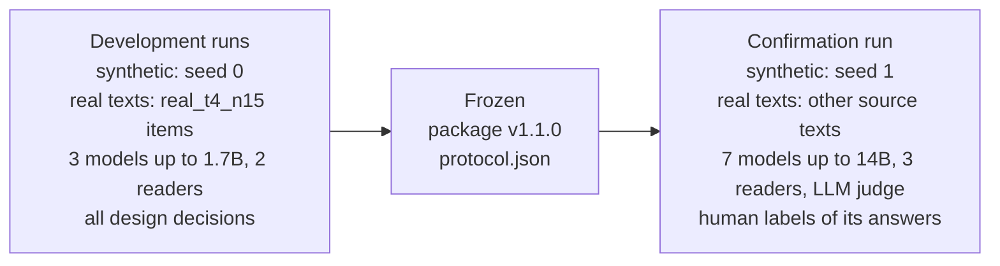
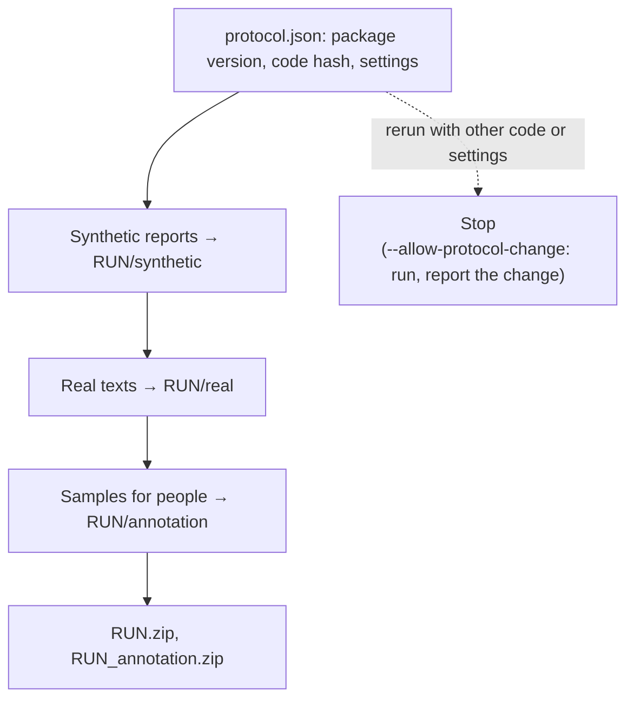

# Protocol of the confirmation run (package v1.1.0)

## Development and confirmation

**Development runs.** Colab T4: `t4_n20` (synthetic reports, item seed 0, 20 items per cell) and `real_t4_n15`
(SQuAD 2.0, MuSiQue, CUAD, Poddar et al.; 15 items per cell); models Qwen2.5-0.5B/1.5B-Instruct and
SmolLM2-1.7B-Instruct; readers Qwen2.5-3B-Instruct and Phi-3.5-mini-instruct; Poddar et al.'s 189 human-labelled
responses; 600 missing-fact answers labelled while the abstention rule was built.

**Confirmation run.** `colab/final_a100.ipynb` or `scripts/run_final.py`, package v1.1.0:
- new synthetic items (seed 1, 30 per cell), new items for the planted-filler check T1 (seed 2027; development:
  2026; the real-text suite does not repeat it as R2);
- real-text items only from source texts the development items do not use (no SQuAD paragraph, MuSiQue question,
  CUAD contract or Poddar et al. question of `real_t4_n15/items.jsonl`; `filter-items --exclude-items`);
- seven models: the three development models, Qwen2.5-7B/14B-Instruct, Llama-3.1-8B-Instruct, Gemma-2-9B-it;
- three readers: the two development readers and Phi-4 (14B; answers to 10 items per cell and the annotation
  sample);
- the LLM judge (Phi-4) and Selective Context (Qwen2.5-3B) on every response with known truth;
- the samples for human labels, drawn from this run's answers.

The annotation sample, once drawn, is never replaced (labels name its responses by uid). Poddar et al.'s cells are
small: without the development questions MS MARCO has about 5 candidate questions before the leakage filter.

## Frozen

| What | Value | Code |
|---|---|---|
| information a response delivers | I_j = max(ln p, ln ε) − max(ln p∅, ln ε), ε = 10⁻⁶ | `drybench.reader` |
| accepted answers | the gold's forms; for a fact they leave undelivered (p < 0.5), also the response's own wording of it (same words up to case, dashes, quotes, apostrophes, digit separators, '&', accents and articles; CUAD dates and terms by value), with up to 8 words of its phrase in front (never across , ( ) : ; or words such as not / or / than / renew…), kept when the reader replies with it at p ≥ 0.02 (best per place, at most 3); the same for each deleted fragment read alone when it is classified | `drybench.forms` |
| tolerance of the filler map | τ = 0.5 nats, slack min(τ, I_j / 2), every delivered fact separately | `drybench.filler` |
| deletion search | leave-one-out queue; a fragment that cannot go with the ones before it is skipped | `drybench.filler` |
| fragments | sentences and list lines | `drybench.segment` |
| kinds of deleted fragments | repeat (≥ half of a delivered fact's information), wrong statement (p ≥ 0.5 on a wrong answer), uninformative | `drybench.filler` |
| missing facts | lexical rule; missing-fact items are left out of the filler tables | `drybench.abstain` |
| readers | chat template; the question about a missing fact per reader | `drybench.reader` |
| leakage filter (real texts) | prior p < 0.05, gold p ≥ 0.5 | `drybench.realdata` |
| baselines | length, Yap excess, stop-word share; LLM judge = fragment labels by the annotation guidelines, read off label probabilities; Selective Context = summed token self-information per fragment, as many characters deleted as the main reader's filler map | `drybench.judge`, `drybench.selective` |
| comparisons | the same responses for every method, and again with the responses a reader reads nothing from (all of such a response removable); true share = planted filler and wrong statements, or the fragments labelled filler / wrong; pairs: true share differs by ≥ 0.2 and the response with more is shorter; partial Spearman given length; 500 bootstrap resamples of items | `drybench.compare` |
| human labels | guidelines of v1.0; item-wise sample, seed 0; truth = the annotator with the most complete labels; a fragment labelled wrong with "+ needed fact" is not removable | `drybench.guidelines`, `drybench.annotate` |

## What the confirmation run tests

Expected from the development runs; each is reported with its interval whichever way it comes out.

1. **Validity on known filler.** On planted filler (T1 synthetic, R3 real texts) every reader loses no fact in
   ≥ 95% of responses and deletes nothing but filler and wrong statements with precision ≥ 0.95.
2. **Not length.** On the same responses the removable share tracks the true share better than length and the Yap
   excess (Spearman); in "shorter but more removable" pairs it ranks the right response higher in most pairs, where
   length does in none; its partial correlation with the truth given length is above zero.
3. **People.** The same on the human labels of the benchmark's own answers, over all pairs and over pairs of answers
   to the same item (where the Yap excess ranks like length); agreement of the filler map with the annotator against
   the agreement of two annotators.
4. **Against an LLM judge and Selective Context**: the same comparisons; the judge is the same model as the 14B
   reader, so the method is compared with the model held fixed. Cost per response (R7/T8).
5. **Models.** Filler by item design; "Be concise." (paired CIs per model); abstention on missing facts per model.
6. **Readers.** Model rankings and the "Be concise." effects agree between the three readers.
7. **Entropy.** The generating model's span entropy flags filler above chance on synthetic reports; on real texts
   reported as it comes (weak in development).
8. **Abstention rule.** Precision and recall of the lexical rule on held-out labels of 150 answers.

## After the run, by hand

1. `annotation/sample.jsonl`: one annotator labels every answer, a second one at least 60
   ([ANNOTATION.md](ANNOTATION.md)).
2. `annotation/abstain_sample.csv`: the label column, without looking at the key.
3. `drybench annotation-report --sample annotation --labels … --abstain-csv …` → `annotation/labels_report.md`.
