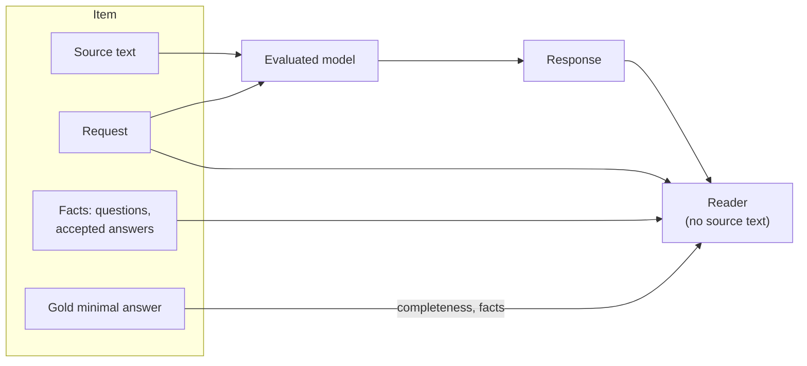
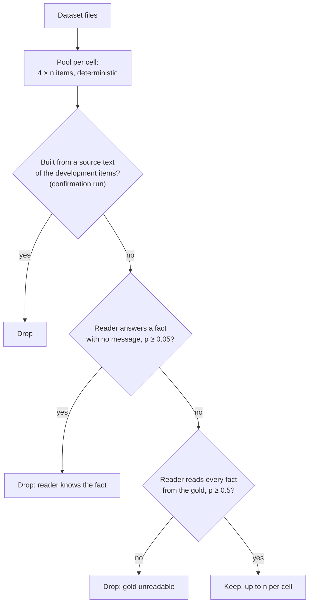

# Benchmark

## Item

Every suite is mapped onto one format (`drybench/types.py`):

| Field | Content |
|---|---|
| `document` | source text; only the evaluated model sees it |
| `request` | what the user asks |
| `probes` | facts: question, accepted answers, value, whether required |
| `gold_minimal` | shortest correct answer |
| `knobs` | design: number of facts `k`, distractors `d`, `answerable`, `ambiguous`, `hops`, `explain`, suite and cell |



Evaluated models get the source and the request in one user turn, greedy decoding, up to 320 new tokens (400 in
the confirmation run). The repetition penalty of each model's generation config applies (Qwen2.5-0.5B/1.5B-Instruct:
1.1; SmolLM2-1.7B-Instruct: none). A response cut at the token limit is not marked.

```text
system: You answer questions about internal operations reports.          (synthetic)
        You answer questions using the provided {text | documents | contract excerpt | story summary | tweet | search results}.
        + " Be concise."                                                  (variant "concise")
user:   {Report | Text | Documents | Contract excerpt | …}:
        {source text}

        Request: {request}
```

## Synthetic reports

An operations report of a terminal: one line per fact about invented shipments, carriers, ports and people. The
reader cannot know any answer without the response.

| Knob | Values | Tests |
|---|---|---|
| `k` | 1, 2, 3, 4, 6 facts | facts should add tokens, filler should not |
| `d` | 0 or 4 lines about other shipments | copying unrequested lines |
| `answerable` | one requested fact missing (k = 1 or 3) | saying "not stated" vs making a value up |
| `ambiguous` | two shipments match the request | covering both briefly |
| `hops` | 2: the answer is looked up through the carrier's record | whether steps are written out |
| `explain` | 2-hop request with "Explain how you found it." | the intermediate fact becomes required |

15 cells: k × d (10), missing fact (2), ambiguous (1), 2-hop with and without "explain" (2). Items are
deterministic in the seed (development: 0; confirmation: 1).

## Real texts

| Suite | Cells | Source | Missing fact | License |
|---|---|---|---|---|
| SQuAD 2.0 dev | k = 1–4 questions in one request; missing with k = 1, 3 | Wikipedia paragraph and title | one of SQuAD 2.0's unanswerable questions | CC BY-SA 4.0 |
| MuSiQue dev | 2, 3, 4 hops × explain; missing with 2 hops | supporting paragraphs + 3 of MuSiQue's distractors | MuSiQue-Full's version without a supporting paragraph | CC BY 4.0 |
| CUAD v1 | k = 1, 2, 3; k = 1 long; missing law with k = 2 | contract excerpt | governing law of an excerpt without its clause | CC BY 4.0 |
| Poddar et al. 2025 | NarrativeQA, TweetQA, MS MARCO | story summary, tweet, search passages | — | GPL-3.0 |

**SQuAD 2.0.** Answers of up to 5 words. No question contains its own canonical answer or the canonical answer to
another question of the same request. Every annotator's answer span is accepted, including spans that disagree
with the majority. Canonical answer: the annotators' majority, ties to the shortest. The unanswerable question
stands at a random position; it is written to look answerable and the text holds a plausible wrong answer.

**MuSiQue.** Paragraphs shuffled and headed "Document i: title". The decomposition steps become standalone
questions ("#1" replaced by the first answer). With "Explain how you found it." every intermediate answer is a
required fact; without it only the final one. Each question is used in one cell only.

**CUAD.** Four of 41 clause categories have short values and become facts: title (Document Name), date (Agreement
Date, parsed; any usual spelling accepted), governing law (the jurisdiction in Governing Law), initial term (from
Expiration Date, e.g. "five (5) years"). Contracts are long (median ~5,000 words), so an item is an excerpt of up to
900 words (1,800 in the long cell): the opening (title, parties, date), the paragraphs with the requested facts and
2 other paragraphs (8 in the long cell), "[...]" for gaps. Distractor paragraphs never come from date, term or law
clauses; the opening and signature blocks can state the title or date a second time. For the missing law the
clause is cut out; "a Delaware corporation" may remain as a plausible wrong answer.

**Poddar et al.** The subsets with a source text (Dolly and GooAQ have none). Reference answers of up to 5 words;
the n-gram of the source closest to the reference (token F1 ≥ 0.75) is also accepted. One item per question. The
same data's 10 LLM responses with human span labels are a validation set ([validation.md](validation.md)).

## Accepted answers

Gold texts plus light variants: without a leading article or preposition, capitalised, without thousands
separators, digits ↔ number words; reduced to a prefix-free set. From v1.1.0 also the response's own wording
([method.md](method.md#accepted-answers-in-the-responses-own-words-v110)).

## Leakage filter

On real text the reader may know a fact from pretraining. Items are drawn from an oversampled pool and checked
with the reader (`drybench filter-items`).



In the development run every cell kept 15 items except MS MARCO (12 of 17 candidates). The counts of dropped items
per cell were overwritten by a later top-up of the filter (table R0 shows 0).

## Missing-fact items

The right answer says the fact is not given. These items are judged by a lexical rule
([method.md](method.md#facts-the-source-does-not-give)) and left out of every filler table.
