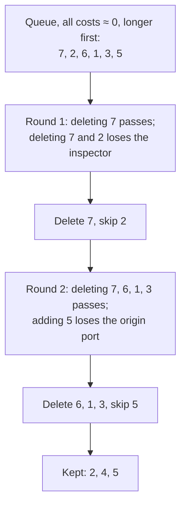

# Worked examples

One response per suite from the development runs, and one case from each check. Texts and numbers are taken from
the result files unchanged; the data is in
[results/dev_v1.0/examples/examples.json](../results/dev_v1.0/examples/examples.json). Reader: Qwen2.5-3B, package
v1.0.0.

- Cost: information lost when only this fragment is deleted, nats. 13.8 nats = the fact's whole information
  (probability from ~10⁻⁶ to ~1). A negative cost: the reader is surer without the fragment.
- ~~Struck out~~: deleted by the filler map.
- With no response the reader gives every correct answer below the floor of 10⁻⁶.

## 1. Synthetic report, 3 facts

Qwen2.5-0.5B, default prompt.

```text
Operations report, Relmi terminal.
The delay of shipment GZ-1638 was caused by a customs audit.
Shipment ZG-8138 was inspected by Marrel Vandra.
Shipment ZG-8138 was handled by Relgor Lines.
Shipment ZG-8138 was bound for Port Peltuqui.
Shipment ZG-8138 departed from Port Taulset.
Shipment GX-5338 was handled by Rakthiset Logistics.
All times are local.
Shipment JF-6062 left on 27 April.
Shipment NZ-1687 used 20 containers.
Shipment ZG-8138 left on 26 March.
```

Request: *For shipment ZG-8138, what were the inspector, the origin port and the destination port?*
Gold: *Inspector: Marrel Vandra. Origin port: Port Taulset. Destination port: Port Peltuqui.* (24 tokens).
Facts: Marrel Vandra, Port Taulset, Port Peltuqui; each read with p = 1.00, 13.8 nats.

| # | Fragment | Cost | Decision |
|---|---|---|---|
| 1 | ~~Based on the information provided in the report:~~ | 0.0 | filler: uninformative |
| 2 | - The shipment ZG-8138 was inspected by Marrel Vandra. | 0.0 | kept |
| 3 | ~~- It was handled by Relgor Lines.~~ | 0.0 | filler: uninformative (not asked) |
| 4 | - It was bound for Port Peltuqui. | 13.8 | kept |
| 5 | - It departed from Port Taulset. | 0.0 | kept |
| 6 | ~~- All times mentioned (departure date, departure port) are correct.~~ | 0.0 | filler: uninformative |
| 7 | ~~Therefore, the inspector for shipment ZG-8138 was Marrel Vandra, it was handled by Relgor Lines, and it departed from Port Taulset.~~ | 0.0 | filler: repeat |

Fragments 2 and 5 cost 0 alone because 7 repeats them. The search:



Kept: *- The shipment ZG-8138 was inspected by Marrel Vandra. - It was bound for Port Peltuqui. - It departed from
Port Taulset.*
Removable 64% · facts 3/3 · completeness 1.00 · overhead ×4.4 = ×2.8 removable × ×1.6 wordiness · tokens 106 → 38,
gold 24.

## 2. SQuAD 2.0, 4 questions about one paragraph

Qwen2.5-0.5B, default prompt.

> *University of Chicago.* In the arts and entertainment, minimalist composer **Philip Glass**, dancer,
> choreographer and leader in the field of dance anthropology Katherine Dunham, Bungie founder and developer of the
> **Halo** video game series Alex Seropian, Serial host Sarah Koenig, actor **Ed Asner**, Pulitzer Prize for
> Criticism winning film critic and the subject of the 2014 documentary film Life Itself Roger Ebert, director,
> writer, and comedian **Mike Nichols**, film director and screenwriter Philip Kaufman, and Carl Van Vechten,
> photographer and writer, are graduates.

Request: *1. What video game series did Alex Seropian make? 2. What American actor is also a university graduate?
3. What minimalist composer is also a university graduate? 4. What comedian is also a university graduate?*
Gold: *1. Halo. 2. Ed Asner. 3. Philip Glass. 4. Mike Nichols.* (20 tokens).
Facts: Halo and Philip Glass read with p = 1.00 (13.8 nats each); Ed Asner and Mike Nichols p = 0.00. 27.6 of 55.3
nats.

| # | Fragment | Cost | Decision |
|---|---|---|---|
| 1 | 1. Alex Seropian made the video game series Halo. | 13.8 | kept |
| 2 | ~~2. The University of Chicago is an American university.~~ | 0.0 | filler: uninformative |
| 3 | 3. Philip Glass is a minimalist composer who graduated from the University of Chicago. | 13.8 | kept |
| 4 | ~~4. The University of Chicago is also an American university.~~ | 0.0 | filler: uninformative |

Questions 2 and 4 got a sentence that answers nothing. It is deleted; the missing answers show in facts and
completeness.

Removable 45% · facts 2/4 · completeness 0.50 · overhead ×5.1 = ×1.8 × ×2.8 · tokens 51 → 28, gold 20.

## 3. MuSiQue, 2 hops

Qwen2.5-1.5B, default prompt. Source: 5 paragraphs (352 words), 2 supporting, 3 distractors (Tuberculosis,
Saint-Laurent-des-Bâtons, Indigenous peoples). The supporting lines:

> **Document 1: Bâton à feu.** The Bâton à feu, or Baston à feu (French for "Fire stick"), is a type of hand cannon
> developed in the 14th century in **Western Europe**. […]
>
> **Document 5: Consequences of the Black Death.** […] The Black Death was one of the most devastating pandemics in
> human history, peaking in Europe between 1347 and 1350 with **30% to 65%** of the population killed. […]

Request: *As a result of the black death it is estimated that the population of the country for Bâton à feu was
reduced by how much?*
Gold: *30% to 65%.* (8 tokens). Without "Explain how you found it." the intermediate answer (Western Europe) is not
required. Fact read with p = 0.94, 13.8 nats.

| # | Fragment | Cost | Decision |
|---|---|---|---|
| 1 | ~~Based on the information provided in Document 5, the consequences of the Black Death included a significant reduction in the population of Europe.~~ | −0.1 | filler: uninformative |
| 2 | ~~Specifically, it states:~~ | 0.1 | filler: uninformative |
| 3 | "Between 1347 and 1350, the Black Death peaked in Europe with 30% to 65% of the population killed." | 13.8 | kept |
| 4 | ~~This indicates that the Black Death led to a substantial decrease in the population of Europe.~~ | 0.0 | filler: uninformative |
| 5 | ~~While the exact percentage varies slightly depending on the source, it generally falls within this range.~~ | 0.0 | filler: uninformative |
| 6 | Therefore, the population of the country where the Bâton à feu was used likely experienced a significant decline as a direct consequence of the Black Death. | 13.8 | kept |

Fragment 6 states nothing new, but the reader does not see the source: without 6 it cannot tie the quoted figure to
"the country for Bâton à feu". Deleting 6 costs the whole fact.

Removable 51% · facts 1/1 · completeness 1.00 · overhead ×16.6 = ×2.0 × ×8.2 · tokens 132 → 65, gold 8.

## 4. CUAD, 3 facts (the v1.0.0 matching error)

Qwen2.5-0.5B, default prompt. Excerpt of 443 words: opening, the paragraphs with the facts, 2 distractor paragraphs.

> Exhibit 10.1 / **COOPERATION AGREEMENT** / This Cooperation Agreement ("Agreement") is entered into as of
> **July 1, 2020**, by and between e.l.f. Beauty, Inc., a Delaware corporation (the "Company"), and Marathon Partners
> Equity Management, LLC […]
>
> (i) This Agreement shall be governed by and construed in accordance with the internal laws of the State of
> **Delaware** applicable to agreements made and to be performed within that state, […]

Request: *1. What is the title of this agreement? 2. What is the date of this agreement? 3. Which jurisdiction's law
governs this agreement?*
Gold: *1. Cooperation Agreement. 2. July 1, 2020. 3. Delaware.* (21 tokens).

| Fact | Accepted answers (v1.0.0) | p | Nats |
|---|---|---|---|
| title | Cooperation Agreement; COOPERATION AGREEMENT | 0.98 | 13.8 |
| date | July 1, 2020; 7/1/2020; 2020-07-01; 1 July 2020; … | 1.00 | 13.8 |
| law | Delaware; DELAWARE; State of Delaware; the State of Delaware; the laws of the State of Delaware | 0.00 | 0 |

| # | Fragment | Cost | Decision |
|---|---|---|---|
| 1 | 1. The title of this agreement is "Cooperation Agreement." | 13.8 | kept |
| 2 | 2. The date of this agreement is July 1, 2020. | 13.8 | kept |
| 3 | ~~3. The jurisdiction's law governing this agreement is the Internal Laws of the State of Delaware.~~ | 0.0 | wrong statement (error) |

Answer 3 is correct. The reader copies "Internal Laws of the State of Delaware", which none of the accepted forms
starts; the fact counts as not delivered and the sentence is deleted as wrong. v1.1.0 adds the response's wording
to the accepted answers ([method.md](method.md#accepted-answers-in-the-responses-own-words-v110)).

v1.0.0: removable 38% (all of it "wrong") · facts 2/3 · completeness 0.67 · overhead ×3.6 · tokens 50 → 31, gold 21.
Expected with v1.1.0: removable 0% · facts 3/3 · overhead from wordiness only.

## 5. Poddar et al., question about a tweet

SmolLM2-1.7B, default prompt.

> It'll be his first visit to Idaho as **President**. It leaves three states he has yet to visit: South Carolina,
> South Dakota and Utah. Mark Knoller (@markknoller) January 21, 2015

Request: *Who is visiting these states?* Gold: *the president.* (3 tokens); accepted: president, President, the
president, The president. Fact read with p = 1.00, 13.8 nats.

| # | Fragment | Cost | Decision |
|---|---|---|---|
| 1 | The tweet is referring to President Barack Obama's first visit to Idaho as President. | 13.8 | kept |
| 2 | ~~He has yet to visit South Carolina, South Dakota, and Utah.~~ | 0.0 | filler: uninformative |

Removable 47% · facts 1/1 · completeness 1.00 · overhead ×10.0 = ×1.9 × ×5.3 · tokens 30 → 16, gold 3.

## 6. Check: planted filler (SQuAD 2.0)

The response is built from the source sentence that states the fact plus filler of known type.
Source: paragraph "Harvard University". Request: *How many academic units make up the school?* Accepted: 11, eleven,
Eleven.

| # | Fragment | Planted as | Cost | Filler map |
|---|---|---|---|---|
| 1 | ~~Here is the information you requested from the text.~~ | restated request | 0.2 | filler ✓ |
| 2 | The University is organized into eleven separate academic units—ten faculties and the Radcliffe Institute for Advanced Study—with campuses throughout the Boston metropolitan area: … | fact | 13.8 | kept ✓ |
| 3 | ~~Please note that the text may not cover every detail.~~ | hedge | 0.0 | filler ✓ |
| 4 | ~~Such details are usually given close to the relevant passage.~~ | generic remark | 0.0 | filler ✓ |
| 5 | ~~Harvard's $37.6 billion financial endowment is the largest of any academic institution.~~ | source sentence, same paragraph | 0.0 | filler ✓ |
| 6 | ~~Let me know if you need anything else.~~ | closing | 0.0 | filler ✓ |

No fact lost · precision 1.00 · recall 5/5 · removable share 37%, true share 37%.

With a planted wrong statement. Source: paragraph "Prime number". Two questions: which other mathematician proved
Fermat's little theorem (Euler), in which year Fermat stated it (1640).

| # | Fragment | Planted as | Cost | Filler map |
|---|---|---|---|---|
| 1 | In 1640 Pierre de Fermat stated (without proof) Fermat's little theorem (later proved by Leibniz and Euler). | fact (both questions) | 26.5 | kept ✓ |
| 2 | ~~The answer to "In what year did Pierre de Fermat declare Fermat's little theorem?" is 1961.~~ | wrong statement | −1.1 | wrong statement ✓ |
| 3 | ~~I hope this helps!~~ | closing | −0.9 | filler ✓ |

Fragment 2 has a negative cost: without it the reader is surer of 1640.

## 7. Check: human labels (Poddar et al.)

Response of Mistral-7B from their data, labelled by people. Needed = fragments labelled minimal answer.

> The **Duchess of Cambridge** hosts #TeamHeadsTogether runners at Kensington Palace, to wish them luck with
> preparing for the @ Kensington Palace (@KensingtonRoyal) April 19, 2017

Question: *Who is hosting team heads together?* Reference: *the duchess of cambridge.*

| # | Fragment | Human label | Cost | Filler map |
|---|---|---|---|---|
| 1 | The Duchess of Cambridge (Kate Middleton) is hosting Team Heads Together. | minimal answer | 13.8 | kept ✓ |
| 2 | ~~She's a big advocate for mental health awareness and this event supports that cause.~~ | additional information | 0.0 | filler ✓ |
| 3 | ~~Good luck to all the runners!~~ | additional information | 0.0 | filler ✓ |
| 4 | ~~#MentalHealthAwareness #TeamHeadsTogether~~ | irrelevant | 0.0 | filler ✓ |

4 of 4 agree; removable 71%. Over all labelled responses F1 is 0.87–0.89 ([results.md](results.md#checks)).
