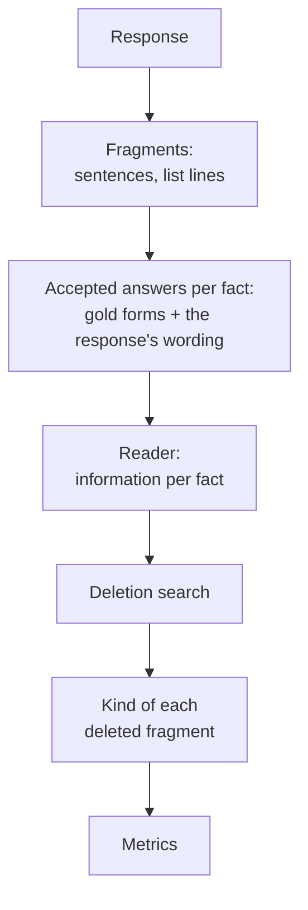
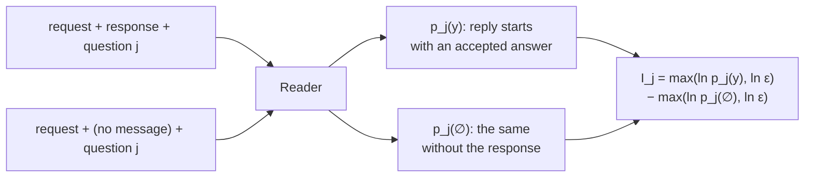
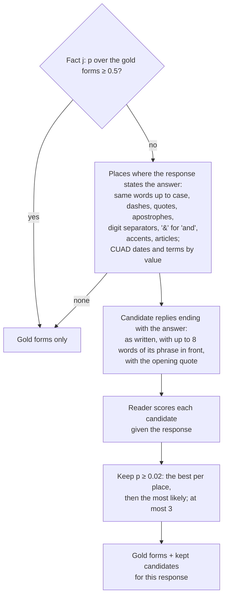
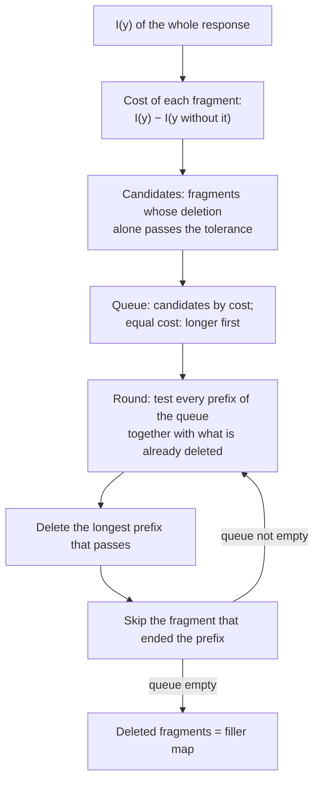
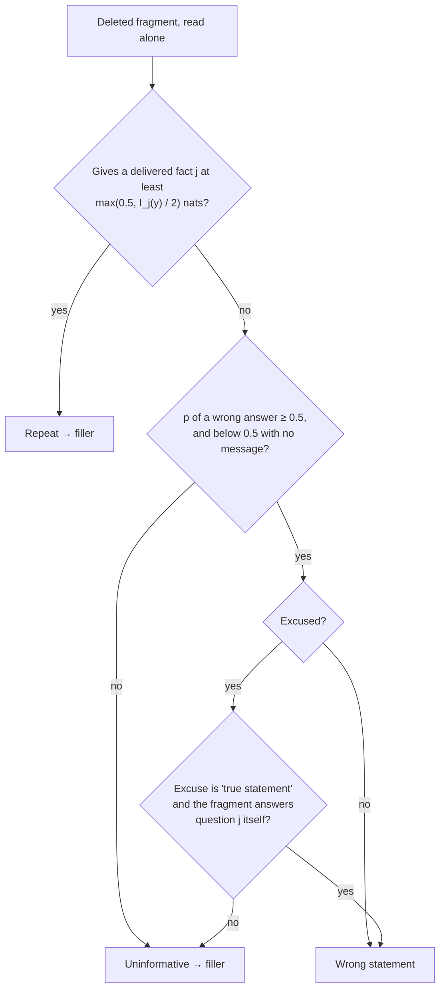
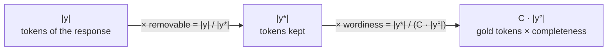
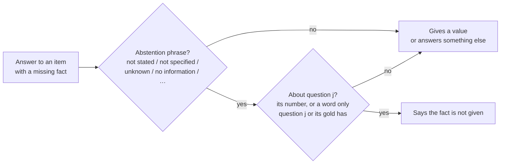
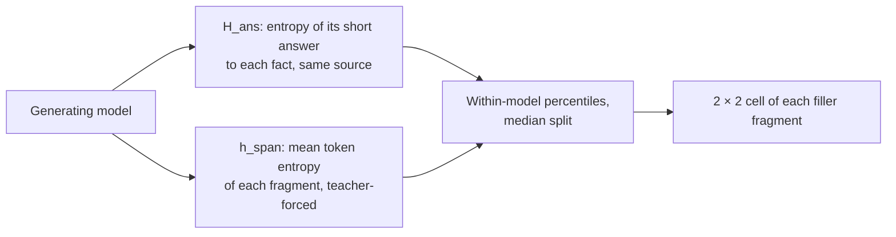

# Method

A fragment of a response is **removable** if a reader model, which sees only the request and the response, still
gets every requested fact without it. Removable fragments are **filler** (uninformative fragments and repeats) or
**wrong statements**. The set of deleted fragments is the **filler map**.



## Code names

| Here | Code, tables |
|---|---|
| filler map | `filler_map`, "filler map" |
| removable share | `W`, "removable" |
| filler share | `W_filler`, "filler" |
| uninformative fragment | kind `uninformative` |
| repeat | kind `duplicate` |
| wrong statement | kind `misleading`, `W_misleading`, "wrong" |
| completeness | `kappa`, κ |
| fact | probe |

## Reader and information

Reader: an instruction-tuned model with a fixed prompt. It never sees the source text.

```text
system: You read a message and answer a question about it. Use only the message. Reply with a short phrase
        copied from the message. If the message does not contain the answer, reply 'unknown'.
user:   Request: {request}
        Message: {response, or "(no message)"}
        Question: {question of fact j}
```

For fact j with accepted answers A_j, p_j is the teacher-forced probability that the reply starts with one of
them (summed over A_j; A_j is prefix-free).

```text
I_j(y) = max(ln p_j(y), ln ε) − max(ln p_j(∅), ln ε)        ε = 10⁻⁶
I(y)   = Σ_j I_j(y)
```



- The floor ε caps a fact at ln 10⁶ = 13.8 nats. Without it a chat reader puts ~10⁻²⁰ on any answer to an empty
  message, and tolerances would scale with that prior.
- A fact the source does not give is asked as a yes/no question ("Does the message say that this is not stated:
  …?") for Qwen2.5-3B; such questions have a floor of 0.1 (at most 2.3 nats). Phi-3.5-mini gets the plain
  question; any reply starting with "not" is accepted.
- The filler map protects every fact with I_j(y) ≥ 0.5 nats (a delivered fact). The **facts** metric counts facts
  read with p_j ≥ 0.5.

## Accepted answers in the response's own words (v1.1.0)

The reader copies the response's wording. Gold forms alone miss a correct answer written differently: "Matthew
Perry" for the gold "matthew perry", "the Internal Laws of the State of Delaware" for "Delaware". v1.0.0 scored
such facts as not delivered. v1.1.0 (`drybench/forms.py`) adds the response's own wording to the accepted
answers, per response.



- The lead in front of the answer stops at `, ( ) [ ] : ; . ! ?`, a spaced dash and words that join or oppose
  another answer (not, or, and, than, renew…). A candidate never starts with a different answer ("David
  Schwimmer, not Matthew Perry").
- Bare numbers and candidates of 2 characters or fewer are not offered: with "starts with" scoring "5" also
  covers "50".
- The same is done for each deleted fragment read alone (next sections), so a fact restated in other words is a
  repeat, not a wrong statement.
- A response that states every fact in the gold's words scores as in v1.0.0. Scored rows store the added
  wordings (`added_answers`). `drybench score --gold-forms-only` scores as v1.0.0.

## Fragments

Sentences and list lines (`drybench/segment.py`). A list number ("2.") stays with its line. Messages are rebuilt
from the remaining fragments joined by spaces.

## Deletion search

Tolerance: a set of deletions is allowed if every delivered fact keeps its information within

```text
I_j(y') ≥ I_j(y) − min(τ, I_j(y) / 2)        τ = 0.5 nats
```

Above the floor this means the reader's probability of each answer falls to no less than e^−0.5 ≈ 0.61 of its
value. The cap I_j/2 makes deleting the only statement of a fact impossible.



Costs within 0.1% of I(y) count as equal. Reader calls per response: about 2n for n fragments (`--mode loo`, the
default of every run). `--mode greedy` (exact greedy, O(n²)) is kept as an option.

## Kind of a deleted fragment

Each deleted fragment is read alone by the same reader.



- Wrong answer: any reply except the accepted answers and non-answers ("unknown", "not…", an echo of the
  question's shipment id).
- Excuses: no words beyond the request (a header such as "For shipment KJ-3299:"); synthetic reports: another
  shipment, or a true value next to its own attribute; real texts: a true statement, i.e. 80% of its words occur
  in one sentence of the source.
- "Answers question j itself": carries j's number in a numbered request, or at least 60% (and 2) of the content
  words of question j. A true sentence of the source can still be the wrong answer.

## Metrics

| Metric | Definition | Code |
|---|---|---|
| removable share | tokens of deleted fragments / tokens of the response | `W` |
| filler share | uninformative + repeats | `W_filler` |
| wrong statements | share of tokens in wrong statements | `W_misleading` |
| facts | share of facts read at p ≥ 0.5, among the facts the reader reads from the gold at p ≥ 0.5 | `facts` |
| complete answers | share of responses with every fact read | tables |
| completeness C | Σ_j max(I_j(y), 0) / I(y°), y° = gold minimal answer | `kappa` |
| overhead | \|y\| / (C · \|y°\|): tokens per delivered nat relative to the gold | `overhead` |
| density | I(y) / ln 2 / \|y\| bits per token | `density_bits_per_token` |

Overhead splits into two factors (geometric means in the tables):



- ×removable: whole fragments that can go. ×wordiness: needed fragments written long ("The carrier for shipment
  NB-3618 was Dralor Cargo." vs "Carrier: Dralor Cargo."). The filler map works on whole fragments and cannot cut
  inside one.
- A response from which the reader reads less than 1 nat delivers nothing: no filler map; facts count it as
  failed. A gold answer the reader cannot read (< 1 nat): the response is not scored.

## Facts the source does not give

Some items ask for a fact that is not in the source; the right answer says so. The reader cannot judge this
reliably (hand labels of 600 development answers: AUC 0.53 on synthetic, 0.79 on real texts for the main
reader). A lexical rule decides (`drybench/abstain.py`).



Against the hand labels: precision 0.99, recall 1.00 (tuned on the same answers; a held-out check is part of the
confirmation run). Items with a missing fact are left out of every filler table and reported separately.

## Entropy signals of the generating model



|  | h_span low | h_span high |
|---|---|---|
| H_ans low (knows) | autopilot | over-elaboration |
| H_ans high (unsure) | template hedge | compensation |

A cell's share of filler tokens is read against its share of all tokens (> 1: over-represented). h_span must come
from the model that wrote the text: scored by GPT-2, assistant boilerplate is not low-entropy (pilot).

## Options and ablations

| Option | Effect |
|---|---|
| `--gold-forms-only` | accepted answers from the gold only (v1.0.0) |
| `--ablation-abs-tol 2` | stores the removable share at τ = 2 nats next to each score |
| `--constraint global` | one budget for the total I(y) instead of per fact; loses low-information facts |
| `--mode greedy` | exact greedy search, O(n²) reader calls |
| prefix ablation | the search stops at the first fragment that fails (no skip); reported in the checks |
