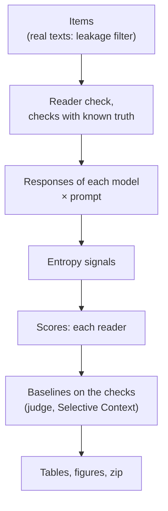
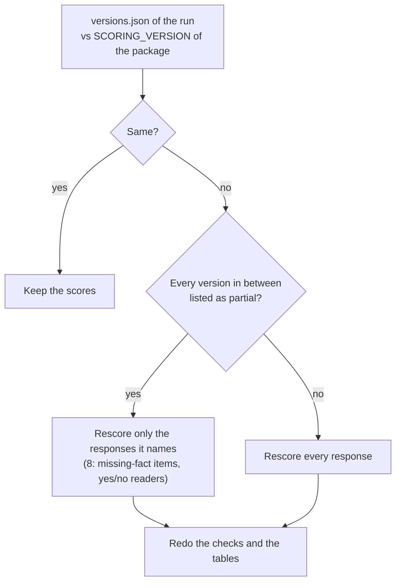

# Running

## Install and test

```bash
pip install -e ".[hf,plot,dev]"      # add ".[onnx]" for the CPU GPT-2 pilot
python -m pytest -q                    # 161 tests (3 skip without local data); mock reader, no GPU
```

Runs with real models need a GPU.

## Pipeline



Every step appends to JSONL and resumes after an interruption. A new `--run` name starts a new run.

## Colab

The notebooks embed the package; nothing to upload. `python scripts/make_colab.py` rebuilds them after code changes.

| Notebook | What | GPU, time |
|---|---|---|
| `colab/drybench_colab.ipynb` | synthetic reports: 3 models × 2 prompts; second reader in its own cell | T4, ~50 min for 300 items; second reader ~45 min |
| `colab/real_texts_colab.ipynb` | SQuAD 2.0, MuSiQue, CUAD, Poddar et al.; checks R1–R6 | T4, ~3 h; resumes from Google Drive |
| `colab/missing_check_colab.ipynb` | ways to ask a reader about a missing fact | T4, ~15 min |
| `colab/final_a100.ipynb` | confirmation run ([PROTOCOL.md](PROTOCOL.md)) | A100, 8–12 h; HF token with Llama and Gemma access |

## GPU server

```bash
python -m pip install -e ".[hf]" accelerate gdown huggingface_hub matplotlib
python scripts/run_synthetic.py --run runs/syn_v1 --n-per-cell 30 --seed 1 --models qwen2.5-7b=Qwen/Qwen2.5-7B-Instruct \
    --readers2 phi3.5-mini=microsoft/Phi-3.5-mini-instruct --judges phi-4=microsoft/phi-4 \
    --selective qwen2.5-3b=Qwen/Qwen2.5-3B-Instruct --missing-check
python scripts/run_real.py --run runs/real_v1                          # 4 models up to 7B by default
python scripts/run_real.py --run runs/cuad_only --suites cuad --n-per-cell 30
python scripts/run_final.py --run runs/final_v1 --dev-items runs/real_t4_n15/items.jsonl   # confirmation run
```

Single steps:

```bash
drybench items    --out items.jsonl --n-per-cell 30
drybench generate --items items.jsonl --out resp.jsonl --backend hf --model Qwen/Qwen2.5-7B-Instruct --model-name qwen7b
drybench signals  --items items.jsonl --responses resp.jsonl --out sig.jsonl --backend hf --model Qwen/Qwen2.5-7B-Instruct --model-name qwen7b
drybench score    --items items.jsonl --responses resp.jsonl --out scored.jsonl --reader-backend hf \
                  --reader Qwen/Qwen2.5-3B-Instruct --mode loo
drybench analyze  --items items.jsonl --scored scored.jsonl --signals sig.jsonl --out-dir report/
python -m drybench.report RUN                                         # tables of a run again
```

## Run folder

```text
RUN/
  items.jsonl  responses.jsonl  signals.jsonl  scored.jsonl   inputs, responses, entropy, scores (main reader)
  versions.json  config.json  reader_check.json               scoring version, settings, reader check
  filler_check/  filler_check_real/  human_check/             planted filler (synthetic, real), Poddar labels
  reader2_<label>/                                             the same for another reader
  report/                                                      CSV tables, figures
  tables_synthetic.md | tables_real.md                         all tables
  annotation/                                                  samples for people (confirmation run)
```

`scored.jsonl`, one row per response: `info`, `W` (removable), `W_filler` (filler), `W_misleading` (wrong),
`kappa`, `facts`, `overhead`, `added_answers`, and `spans` with `kept`, `kind`, `loo_cost`.

## Rescoring

A change of `SCORING_VERSION` (`drybench/__init__.py`) makes a resumed run recompute its scores. Responses, items and
entropy signals are kept.



v1.1.0 (scoring version 9) rescores everything. To rescore the development runs:

1. Rerun `colab/real_texts_colab.ipynb` on run `real_t4_n15` and `colab/drybench_colab.ipynb` on run `t4_n20`, the
   same Google Drive folders.
2. Compare the tables with `results/dev_v1.0`; the synthetic ones should barely move.
3. Check `added_answers` in `scored.jsonl`, above all wordings with a comma, a bracket, "not" or "or" before the
   answer, and very short ones.
4. Then the confirmation run.

## Looking inside a run

```bash
python scripts/show_checks.py filler RUN/filler_check/rows.jsonl RUN/reader2_*/filler_check/rows.jsonl
python scripts/show_checks.py readers RUN                                  # main vs second reader
python scripts/show_checks.py examples RUN --model qwen2.5-0.5b --variant default   # before / after deletion
python scripts/trace_response.py RUN --model qwen2.5-0.5b --item sq00-0003 --out trace.json   # every reader call
```

## Pilot without a GPU

```bash
bash scripts/get_pilot_assets.sh assets          # GPT-2 ONNX and BPE files
python scripts/pilot_validation.py --assets assets --out-dir results/pilot --n-per-cell 6   # ~18 min, 2 CPU cores
```
