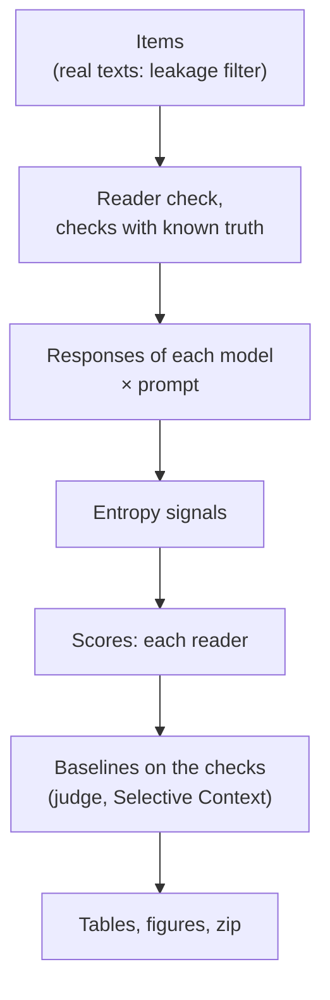
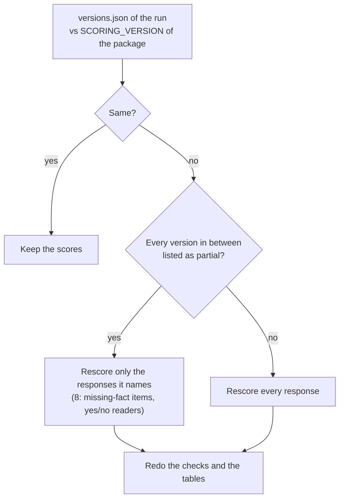

# Running

## Install and test

```bash
pip install -e ".[hf,plot,dev]"      # add ".[onnx]" for the CPU GPT-2 pilot
python -m pytest -q                    # 214 tests (3 skip without local data); mock reader, no GPU
```

Runs with real models need a GPU.

## Pipeline



Every step appends to JSONL and resumes after an interruption; a last line cut by an interrupted write is dropped
before the next append. Responses and scores store their settings (model and revision, dtype, decoding, token
limit; reader, scoring version and options): a resumed step with other settings stops instead of mixing rows
(v1.2). A new `--run` name starts a new run.

## Colab

The notebooks embed the package; nothing to upload. It is the first code cell, *Package*, with its code hidden: run
it first, then the main cell (Runtime → Run all runs every cell in order). `python scripts/make_colab.py` rebuilds
the notebooks after code changes.

| Notebook | What | GPU, time |
|---|---|---|
| `colab/drybench_colab.ipynb` | synthetic reports: 3 models × 2 prompts; second reader in its own cell | T4, ~50 min for 300 items; second reader ~45 min |
| `colab/real_texts_colab.ipynb` | SQuAD 2.0, MuSiQue, CUAD, Poddar et al.; checks R1–R6 | T4, ~3 h; resumes from Google Drive |
| `colab/missing_check_colab.ipynb` | ways to ask a reader about a missing fact | T4, ~15 min |
| `colab/dev_baselines_a100.ipynb` | on the confirmation run's machine: the local models described, the main reader against both development runs' scores, the LLM judge (Qwen2.5-14B) and Selective Context on both runs; development values of the confirmatory tests | A100, 1–2 h |
| `colab/final_a100.ipynb` | confirmation run ([PROTOCOL.md](PROTOCOL.md)) | A100 40 GB, 6–10 h |

## A server with local models

The notebooks run outside Colab too (Jupyter on the server): `USE_DRIVE = False`, `RUN_ROOT` (the runs and
`data/`), `LOCAL` (Hugging Face id → local model folder; with every model local nothing is fetched from the hub),
`PIP = False` (nothing installed: the package runs from its folder with the server's numpy, pandas, scipy, torch,
transformers), `GPU`.

1. `colab/probe_models.ipynb` (or `python scripts/probe_models.py DIR [DIR ...]`): for each local model folder,
   whether it loads, answers a report request in plain text, reads the facts of a gold answer and labels fragments
   as a judge, and the GPU memory it takes.
2. Copy into `RUN_ROOT`: both development runs (`t4_n20_v12/`, `real_t4_n15_v12/`) and `data/squad2`,
   `data/musique`, `data/cuad` (the files the development runs used; the confirmation run checks their sha256).
3. `colab/dev_baselines_a100.ipynb` → `RUN_ROOT/dev_v12_results.zip`: `models.jsonl` (each local folder's origin
   and size), `reader_equivalence/summary.md` (`scripts/compare_reader.py`: 40 responses per run scored again by
   the main reader in fp16 and bf16, against the development scores), the judge and Selective Context in both
   runs, their tables, the development values.
4. `colab/final_a100.ipynb`: the confirmation run, `RUN_ROOT/final_v1`.

## GPU server

```bash
python -m pip install -e ".[hf,data,plot]"
python scripts/run_synthetic.py --run runs/syn_v1 --n-per-cell 30 --seed 1 --models qwen2.5-7b=Qwen/Qwen2.5-7B-Instruct \
    --readers2 phi3.5-mini=microsoft/Phi-3.5-mini-instruct --judges qwen2.5-14b=Qwen/Qwen2.5-14B-Instruct \
    --selective qwen2.5-3b=Qwen/Qwen2.5-3B-Instruct --missing-check
python scripts/run_real.py --run runs/real_v1                          # 4 models up to 7B by default
python scripts/run_real.py --run runs/cuad_only --suites cuad --n-per-cell 30
python scripts/run_final.py --print-hash                              # version and code hash (PROTOCOL.md)
python scripts/run_final.py --run runs/final_v1 \
    --dev-items results/dev_v1.0/real/items.jsonl runs/real_t4_n15_v12/items.jsonl   # confirmation run
python scripts/compare_reader.py runs/t4_n20_v12 runs/real_t4_n15_v12 --reader /models/Qwen2.5-3B-Instruct \
    --dtype fp16 bf16                                                 # a reader against a run's scores
```

`run_final.py` takes local model folders in place of Hugging Face ids (`--models llama3.2-3b=/models/...`); when
every model is one, nothing is fetched from the hub and the datasets must already be in `--data`.

Single steps:

```bash
drybench items    --out items.jsonl --n-per-cell 30
drybench generate --items items.jsonl --out resp.jsonl --backend hf --model Qwen/Qwen2.5-7B-Instruct --model-name qwen7b \
                  --variant default concise --max-new-tokens 400                                   # plain greedy
drybench signals  --items items.jsonl --responses resp.jsonl --out sig.jsonl --backend hf --model Qwen/Qwen2.5-7B-Instruct --model-name qwen7b
drybench score    --items items.jsonl --responses resp.jsonl --out scored.jsonl --reader-backend hf \
                  --reader Qwen/Qwen2.5-3B-Instruct --mode loo
drybench analyze  --items items.jsonl --scored scored.jsonl --signals sig.jsonl --out-dir report/
python -m drybench.report RUN                                         # tables of a run again
drybench confirm --run RUN --labels span_labels_*.json                # the confirmatory tests (PROTOCOL.md)
```

## Run folder

```text
RUN/
  items.jsonl  responses.jsonl  signals.jsonl  scored.jsonl   inputs, responses, entropy, scores (main reader)
  versions.json  config.json  reader_check.json               scoring version, settings, reader check
  filler_check/  filler_check_real/  human_check/             planted filler (synthetic, real), Poddar labels
  reader2_<label>/                                             the same for another reader
  report/                                                      CSV tables, figures
  tables_synthetic.md | tables_real.md                         all tables
  annotation/                                                  samples for people (confirmation run)
  protocol.json  hardware.json  confirmatory.md                confirmation run: settings, GPUs, the eight tests
```

`scored.jsonl`, one row per response: `info`, `W` (removable), `W_filler` (filler), `W_misleading` (wrong),
`kappa`, `facts`, `overhead`, `added_answers`, and `spans` with `kept`, `kind`, `loo_cost`.

## Rescoring

A change of `SCORING_VERSION` (`drybench/__init__.py`) makes a resumed run recompute its scores. Responses, items and
entropy signals are kept.



v1.2.2 changes reports only (scoring version 11 stays): the tables of a run of v1.2.1 are remade from its rows.
v1.2.1 (scoring version 11) changes synthetic reports only: a run of v1.2.0 rescores the answers to synthetic items
and the synthetic planted-filler check, and keeps its real-text scores. v1.2.0 (scoring version 10) also changed
SQuAD 2.0 items and decoding, so the development runs are made again under new names instead of rescored:

1. `colab/drybench_colab.ipynb`, `RUN_NAME = "t4_n20_v12"` (the default), then its second-reader cell.
2. `colab/real_texts_colab.ipynb`, `RUN_NAME = "real_t4_n15_v12"` (the default).
3. `colab/dev_baselines_a100.ipynb` on the confirmation run's machine (a server: [above](#a-server-with-local-models)):
   the main reader against the runs' scores, the judge and Selective Context on both runs, the tables again, the
   development values of the confirmatory tests, everything in `dev_v12_results.zip`.
4. Compare with `results/dev_v1.0`; check `added_answers` in `scored.jsonl`, above all wordings with a comma, a
   bracket, "not" or "or" before the answer, and very short ones.
5. The development values and the thresholds of H1 into
   [PROTOCOL.md](PROTOCOL.md#fixed-before-the-confirmation-run), then `colab/final_a100.ipynb`. H1 on R3 (decided
   before the development intervals of v1.2.1 were computed, after its point values showed a fact lost in 9.2% of
   the responses): the truth stays strict; the thresholds are the main reader's development 95% CI bounds rounded
   outward, the share of responses with a lost fact up to a multiple of 5 points and the precision down to a
   multiple of 0.05; the confirmation run's R3 has 8 items per cell instead of 4. H1 on T1 keeps 5% and 0.95.
   Applied in v1.2.5: [4.7%, 14.3%] → 15%, [0.8996, 0.969] → 0.85 (`drybench.confirm.H1_NULLS`).

## Looking inside a run

```bash
python scripts/show_checks.py filler RUN/filler_check/rows.jsonl RUN/reader2_*/filler_check/rows.jsonl
python scripts/show_checks.py readers RUN                                  # main vs second reader
python scripts/show_checks.py examples RUN --model qwen2.5-0.5b --variant default   # before / after deletion
python scripts/trace_response.py RUN --model qwen2.5-0.5b --item sq00-0003 --out trace.json   # every reader call
python scripts/r3_losses.py RUN --examples 5 --csv mentions.csv   # R3: why a fact counts as lost
```

## Pilot without a GPU

```bash
bash scripts/get_pilot_assets.sh assets          # GPT-2 ONNX and BPE files
python scripts/pilot_validation.py --assets assets --out-dir results/pilot --n-per-cell 6   # ~18 min, 2 CPU cores
```
