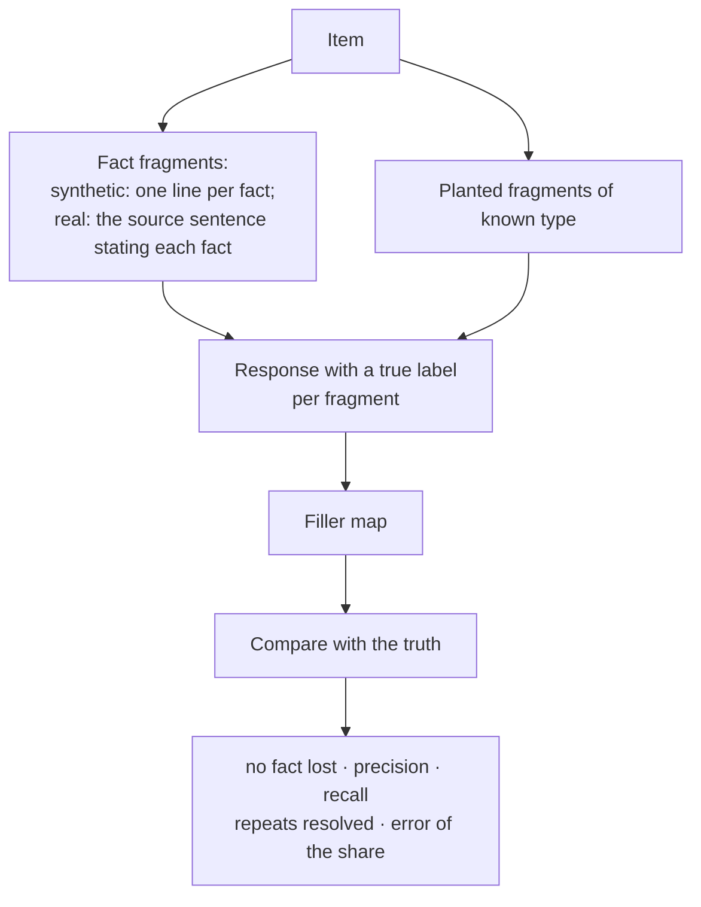
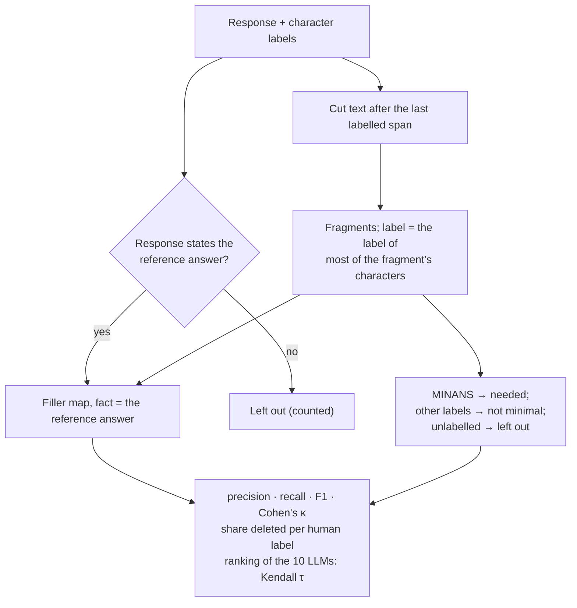
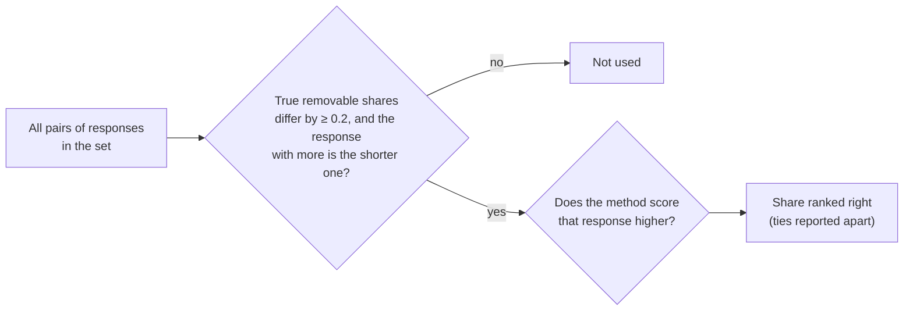

# Validation

Checks with known truth, run for every reader. Table ids: `T*` in `tables_synthetic.md`, `R*` in
`tables_real.md`. Numbers of the development runs: [results.md](results.md).

| Check | Truth | Tables |
|---|---|---|
| Reader check | gold answers with and without each fact | T1 (bottom), R1 |
| Planted filler, synthetic | responses built from fact lines + filler of known type | T1, R2 |
| Planted filler, real texts | the item's own source sentences + filler of known type, one wrong statement | R3 |
| Human labels, Poddar et al. | 10 LLMs' responses with span labels by people | R4 |
| Baselines | the responses of the three checks above | T1, R5 |
| Second reader | the same responses scored by another reader | T4, "Agreement between readers" |
| Human labels of the benchmark's answers | sample of the confirmation run | `labels_report.md`, `confirmatory.md` (pending) |
| Abstention rule, held out | 150 missing-fact answers | `labels_report.md` (pending) |

## Reader check

| Number | Meaning |
|---|---|
| AUC present vs absent | information of a fact when the gold states it vs when it is left out |
| gold unreadable | share of gold answers the reader reads less than 1 nat from |
| wrong-statement detection | share of questions the reader answers "unknown" with no message; wrong statements are detectable only then |
| nats per fact | median information of a stated fact (cap 13.8) |

## Planted filler

Conditions per item: no filler, 2 or 5 filler fragments, 2 with one fact left out; real texts also 1 filler + 1
wrong statement.

Real texts (v1.2): the fact fragment is the source sentence that states the fact, preferring one that states no
other requested answer; items whose facts the source does not state in a sentence of its own are left out. The
truth counts a fact as stated by its chosen sentence and by the summary only: a planted source sentence that merely
mentions the answer ("VerticalNet, Inc., a Pennsylvania corporation" for the governing law) does not state it, so
deleting the chosen sentence loses the fact (up to v1.1 the truth counted such mentions).

| Planted type | Synthetic | Real texts |
|---|---|---|
| opener, restated request, hedge, closing | yes | yes |
| generic remark ("Carriers, ports and cargo types can vary a lot between shipments.") | yes | yes |
| true but unrequested fact about the shipment; a line about another shipment | yes | — |
| true source sentence from the fact's paragraph or another paragraph | — | yes |
| summary that repeats the facts | yes | yes |
| wrong statement: another item's answer given as the answer | — | yes |

- **No fact lost**: share of responses whose remaining fragments still deliver every fact.
- **Precision**: share of deleted fragments that were planted filler or wrong statements (a fact fragment whose
  facts another kept fragment states may go).
- **Recall**: share of planted filler fragments deleted (95% CI, bootstrap over items).
- **Repeats resolved**: no fact is stated twice after deletion (either copy may go).
- **Error of the share**: measured − true removable share, by characters; true = the planted filler, the summary
  included (the guidelines keep the first statement of a fact), and wrong statements (v1.2.2; up to v1.2.1 the
  shortest set of fragments that states every fact, which counted the source sentences as removable whenever the
  summary was shorter).
- A planted fragment left in is reported as "costs more than the tolerance alone" or "blocked in the queue".
- Responses from which the reader reads no fact have no filler map; recall is reported without and with them
  (their planted filler counted as not deleted).

## Human labels (Poddar et al.)

Poddar et al. (2025) labelled 500 responses of 10 LLMs character by character: minimal answer (MINANS), additional
information, explanation, conversational, redundant, irrelevant. Used: the passage subsets with a reference answer
of up to 6 words (189 responses; the benchmark's own Poddar et al. items use up to 5).

Annotators marked the minimal answer whether or not it was right, so a response with another answer has no truth
the filler map can match. Up to v1.1 the reader was given the MINANS fragments to find such a response's own
answer, and the human labels entered the method. v1.2 scores only the responses that state the reference answer
(one of its accepted forms) and counts the others. R4 is development evidence: Poddar et al. is not a suite of the
confirmation run.

## Baselines

All methods are scored on the same responses.

| Method | Removable score |
|---|---|
| length | characters |
| Yap excess | characters beyond the gold minimal answer, as in YapBench (arXiv:2601.00624) |
| stop-word share | share of English stop words |
| LLM judge | per fragment: p(filler) + p(wrong), read off the probabilities of the label words (`needed`, `filler`, `wrong`); the annotators' guidelines (`drybench/judge.py`) |
| Selective Context | least self-information first, as many characters as the filler map deletes (`drybench/selective.py`) |

Fragment level: F1, Cohen's κ, AUC of removable vs needed (the filler map's score: minus each fragment's
leave-one-out cost). Response level, the primary metrics: pairwise accuracy (pairs whose true removable shares
differ by ≥ 0.2; the share where the method scores the response with more filler higher, ties half; over all pairs
and over pairs of answers to the same item) and Spearman with the true removable share, both with 95% CIs
(bootstrap over items). Also: partial Spearman given length, and the pair test:

Length is wrong on every such pair by construction. Responses from which a reader reads nothing are reported both
without and with them (then all of such a response counts as removable).

## Second reader

The same responses scored by other readers (development: Phi-3.5-mini; confirmation: Phi-4-mini, another family,
and Qwen2.5-14B, the main reader's family at 14B). Reported: Spearman per response, Kendall τ of the model × prompt
ranking, agreement per fragment (deleted or kept, Cohen's κ).
